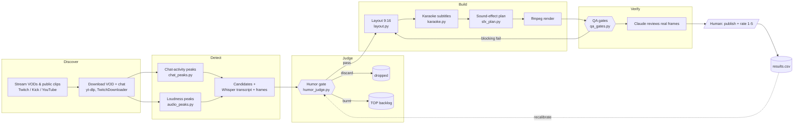

# Architecture

## End-to-end flow

The loop at the bottom is the point of the whole design: every published Short
produces a human rating and real view/retention numbers, and those flow back
into the judge's weights and the written lessons.

## Why the stages are split this way

| Stage | Done by | Why |
|---|---|---|
| Peak detection | deterministic Python | Cheap, repeatable, testable. Finds *energy*. |
| Humor gate | LLM fills a scorecard, Python scores it | Funniness needs vision + language understanding, but the *decision* must be auditable and recalibratable, so arithmetic stays in code. |
| Layout, subtitles, SFX, render | deterministic Python + ffmpeg | A render is a pure function of a config: re-runnable and diffable. |
| QA gates | deterministic Python | Hard rules never rely on a model's mood. |
| Frame review | LLM looks at real frames | "Looks fine" is only allowed after actually viewing extracted frames. |
| Publish + taste | human | The only irreversible step stays with a person. |

## Where it runs

Heavy work (download, transcription, render) runs on the owner's Mac, because
the cloud sandbox cannot reach Twitch or yt-dlp. Claude threads running in the
cloud drive it through an approved folder or a Remote Control session. Nothing
is installed, published, paid for or deleted without an explicit yes.
